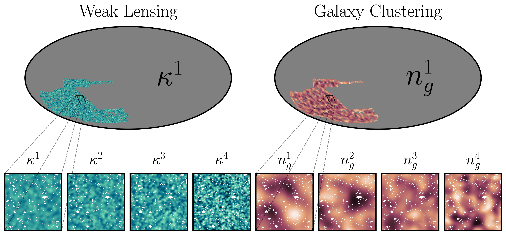
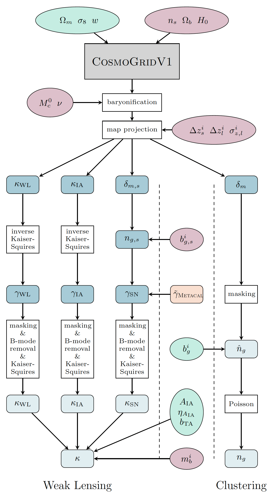

# multiprobe-simulation-forward-model
[](https://arxiv.org/abs/2511.04681)
[](LICENSE)

Forward model for Dark Energy Survey Year 3 (DES Y3)-like weak lensing and galaxy clustering mocks, built from cosmological simulations [[Thomsen et al. 2026](https://arxiv.org/abs/2511.04681)].

- **Input:** Full-sky probe maps (weak lensing signal, intrinsic alignments, and dark matter density) from the [CosmoGridV1](http://www.cosmogrid.ai/) simulation suite [[Kacprzak & Fluri et al. 2022](https://arxiv.org/abs/2209.04662)], projected using [`cosmogridv11`](https://github.com/CosmoGridCollab/cosmogridv11)
- **Output:** Self-consistent DES Y3-like weak lensing (convergence) and galaxy clustering (linear bias) maps with realistic survey properties, written as `.tfrecord` tensors
- **Deep learning integration:** Data storage and loading are designed for the training pipeline in [`y3-deep-lss`](https://github.com/des-science/y3-deep-lss)



## The analysis pipeline

This repository is the first of three stages:

```
CosmoGridV1 simulations
        |
        v
multiprobe-simulation-forward-model    DES Y3-like WL + GC maps in .tfrecord     <-- this repository
        |
        v
y3-deep-lss                            low-dimensional neural summary statistics
        |
        v
multiprobe-simulation-inference        cosmological posterior constraints
```

[`deepsphere-cosmo-tf2`](https://github.com/deepsphere/deepsphere-cosmo-tf2) supplies the graph convolutional layers on the HEALPix sphere that `y3-deep-lss` builds on.
For a full environment, install in dependency order: `deepsphere-cosmo-tf2` → `multiprobe-simulation-forward-model` → `y3-deep-lss` → `multiprobe-simulation-inference`.

## Installation

Requires Python >= 3.8, TensorFlow >= 2.0, and TensorFlow-Probability.

**Dependencies.** All runtime dependencies are declared in [`pyproject.toml`](pyproject.toml) and install automatically. The ones worth knowing about:

| Package | Why it is needed |
|---|---|
| [`healpy`](https://healpy.readthedocs.io/) | HEALPix pixelization, spherical harmonic transforms |
| [`esub-epipe`](https://cosmo-gitlab.phys.ethz.ch/cosmo_public/esub-epipe) | Job submission framework; the postprocessing apps are esub executables |
| `tensorflow`, `tensorflow-probability` | `.tfrecord` serialization and the `tf.data` training pipelines |

**Install.**

*On clusters where TensorFlow is already provided* (recommended — preserves the optimized GPU/MPI build):

```bash
pip install -e .
```

*Elsewhere:*

```bash
pip install -e .[tf]
```

**Extras** declared in [`pyproject.toml`](pyproject.toml):

| Extra | Adds |
|---|---|
| `tf` | `tensorflow>=2.0`, `tensorflow-probability` |
| `dev` | `pytest`, `pytest-cov`, `black`, `flake8`, `ipython`, `jupyter` |

## Quickstart

Forward-model a single CosmoGrid cosmology into DES Y3-like maps, running serially on the
local machine. The postprocessing apps are [`esub`](https://cosmo-gitlab.phys.ethz.ch/cosmo_public/esub-epipe)
executables (`resources` / `setup` / `main` / `merge`), so they are always launched through
`esub`; `--mode=run` is the local, single-process mode.

```bash
esub msfm/apps/run_single_postprocessing.py \
    --dir_in=/path/to/CosmoGrid/bary/grid/cosmo_008963 \
    --dir_out=/path/to/output \
    --msfm_config=configs/desy3/v18/default.yaml \
    --with_lensing --with_clustering \
    --mode=run --function=all --tasks="0" --n_jobs=1
```

Before the first run, generate `data/desy3/desy3_noise_512.h5` — it exceeds the repository's file
size limit and ships only as the notebook that builds it (see [Conventions](#conventions)).

## Usage

### Entry points

All four live in [`msfm/apps/`](msfm/apps/).

| App | What it does |
|---|---|
| `run_grid_postprocessing.py` | Cuts the full-sky maps into DES Y3 footprint mocks across the **cosmology grid**. The main loop runs over cosmologies, with astrophysical nuisance parameters drawn from a Sobol/Latin-hypercube sample. Parallelized over output `.tfrecord` files, one per job-array element. |
| `run_fiducial_postprocessing.py` | The same forward model, but the main loop runs over **simulation permutations** at the fiducial cosmology and its finite-difference perturbations. Astrophysical amplitudes come from the config rather than the hypercube, and the per-example multiplicative-bias draw is shared between fiducial and perturbations so the finite differences stay consistent. `--no_derivatives` skips the perturbations. |
| `run_single_postprocessing.py` | The same forward model for a **single cosmology** — used for mock observations and forward-model variants. Carries the switches that define a variant: `--noiseless`, `--noise_only`, `--reduced_shear`, `--bta`, `--contaminate_survey_systematics`. |
| `run_fisher_forecast.py` | Gaussian-$C_\ell$ Fisher forecasts (wraps [`msfm/utils/fisher.py`](msfm/utils/fisher.py)). Reads a small YAML spec and prints marginalized constraints plus pairwise comparisons. The only app that is *not* an esub executable: `python -m msfm.apps.run_fisher_forecast --spec configs/desy3/v17/fisher_bmode.yaml`. |

### Configuration

One YAML per forward-model generation under [`configs/`](configs/), grouped by survey as
`configs/<survey>/<version>/<subversion>.yaml` (`configs/desy3/v18/default.yaml`,
`configs/desy6/v1/default.yaml`; see [`configs/README.md`](configs/README.md)), defining survey properties
(galaxy number densities, shear-calibration priors, response factors, tomographic bins for both
the metacalibration source sample and the MagLim lens sample), the input data paths, the
parameter priors, and the forward-modeling switches. The config is passed to every app as
`--config` (`--msfm_config` for `run_single_postprocessing.py`), and the *same file* is later
handed to `y3-deep-lss` as `--msfm_config` so training reads the survey definition the data was
built with.

### Submission

Submission commands live in [`pipelines/`](pipelines/), one directory per survey and
forward-model generation, mirroring `configs/` 1:1. Two modes, documented with their trade-offs in
[`pipelines/README.md`](pipelines/README.md):

- **esub / shared queue** — `pipe.yaml` (grid and fiducial production, run via `epipe`) and
  `esub/obs_commands.sh` (ad-hoc single-postprocessing commands) are copy-paste command
  listings that queue one job-array element per output file.
- **packed / exclusive-node queue** — executables under `pipelines/common/packed/` that hand-pack
  many tasks onto whole nodes, each pinned to a NUMA domain. This exists because the binding
  limit is memory *bandwidth*, not capacity: the spherical harmonic transforms saturate a NUMA
  domain's controllers well before its RAM fills, so the packing density is tuned to that knee.

## How the forward model works

<a href="data/figures/pipeline.png"></a>

## Repository layout

```
msfm/
  apps/                  the four entry points above (+ deprecated/)
  utils/                 the forward model itself, one module per concern:
                           lensing, clustering, redshift, scales, power_spectra,
                           source_clustering_bias, observation, postprocessing,
                           tfrecords, cosmogrid, prior, parameters, fisher, ...
  fiducial_pipeline.py   tf.data generator for the fiducial dataset
  grid_pipeline.py       tf.data generator for the cosmology-grid dataset
configs/                 forward-model configs, <survey>/<version>/ (desy3/, desy6/) -- see its README.md
pipelines/               submission commands, mirroring configs/ 1:1 -- see its README.md
data/                    inputs to the forward model -- see its README.md
notebooks/               the notebooks that produce data/, one per product
dev/                     exploratory analysis and audit notebooks/scripts; not part of the
                         release path and not required to reproduce the paper
```

### `data`

CosmoGridV1 properties, survey masks, redshift distributions, and the catalog ellipticities
used to generate shape noise. Each survey has its own subdirectory with its own README, which
says where every file comes from: [`data/desy3/`](data/desy3/README.md) and
[`data/desy6/`](data/desy6/README.md). The top level holds only survey-agnostic inputs, see
[`data/README.md`](data/README.md).

### `notebooks`

The DES Y3 production set: each notebook in `notebooks/desy3/` generates one product in
`data/desy3/` ([`data/desy3/README.md`](data/desy3/README.md) maps them 1:1). DES Y6 uses a script
instead, `msfm/apps/products/desy6.py`. The exception is `products.ipynb`, in both
`notebooks/desy3/` and `notebooks/desy6/`, which reviews a survey's products and writes nothing.
The analysis and comparison notebooks that *consume* the products live in `dev/notebooks/`.

## Conventions

- **`data/desy3/desy3_noise_512.h5` is not in the repository.** It exceeds the file size limit
  and must be regenerated from the source galaxy catalog via
  [`notebooks/desy3/noise_file.ipynb`](notebooks/desy3/noise_file.ipynb) before the first run.
- **`configs/<survey>/vNN/` and `pipelines/<survey>/vNN/` are versioned together.** A config generation and its
  submission commands always carry the same number; changing one without the other produces
  a run that does not match its own submission recipe.
- **Each survey's `data/<survey>/` top level is a closed set.** It is exactly what that survey's
  production config reads — nothing else. Regenerable products go in `data/<survey>/cache/`,
  superseded ones in `data/<survey>/deprecated/`, so that "is this file still used?" is
  answerable from the path alone. Nothing survey-specific sits at the `data/` top level.
- **Write scientific-notation floats with an explicit decimal point.** In YAML, a bare `1e-3`
  parses as a *string*; `1.0e-3` parses as a float. The string silently propagates.

## Troubleshooting

| Symptom | Cause and fix |
|---|---|
| `FileNotFoundError: .../desy3_noise_512.h5` | The noise file is not shipped. Generate it with `notebooks/noise_file.ipynb`. |
| esub reports that a config or app path does not exist | The esub command listings use paths relative to their own pipeline directory. Run them with `cwd = pipelines/vNN`, regardless of which file the command text lives in. |
| A parameter behaves as if it were disabled, with no error | A bare `1e-3` in the config YAML parsed as a string. Write `1.0e-3`. |
| A packed node job is killed at its walltime cap | The cap is per packed node, not per task. See `pipelines/common/packed/README.md` for the sizing arithmetic. |

## Companion repositories

| Repository | Package | Role |
|---|---|---|
| **`multiprobe-simulation-forward-model`** (this repository) | `msfm` | Forward-models DES Y3-like weak lensing and galaxy clustering maps from CosmoGridV1 |
| [`y3-deep-lss`](https://github.com/des-science/y3-deep-lss) | `deep_lss` | Trains networks that compress those maps into informative summary statistics |
| [`multiprobe-simulation-inference`](https://github.com/des-science/multiprobe-simulation-inference) | `msi` | Turns summary statistics into cosmological posterior constraints |
| [`deepsphere-cosmo-tf2`](https://github.com/deepsphere/deepsphere-cosmo-tf2) | `deepsphere` | Graph convolutional layers on the HEALPix sphere, used by `y3-deep-lss` |

## License and citation

Released under the terms of the [MIT license](LICENSE).

If you use this code, please cite:

```bibtex
@misc{thomsen2026darkenergysurveyyear,
      title={Dark Energy Survey Year 3 results: Simulation-based $w$CDM inference from weak lensing and galaxy clustering maps with deep learning: Analysis design},
      author={A. Thomsen and J. Bucko and T. Kacprzak and V. Ajani and J. Fluri and A. Refregier and D. Anbajagane and F. J. Castander and A. Ferté and M. Gatti and N. Jeffrey and A. Alarcon and A. Amon and K. Bechtol and M. R. Becker and G. M. Bernstein and A. Campos and A. Carnero Rosell and C. Chang and R. Chen and A. Choi and M. Crocce and C. Davis and J. DeRose and S. Dodelson and C. Doux and K. Eckert and J. Elvin-Poole and S. Everett and P. Fosalba and D. Gruen and I. Harrison and K. Herner and E. M. Huff and M. Jarvis and N. Kuropatkin and P. -F. Leget and N. MacCrann and J. McCullough and J. Myles and A. Navarro-Alsina and S. Pandey and A. Porredon and J. Prat and M. Raveri and M. Rodriguez-Monroy and R. P. Rollins and A. Roodman and E. S. Rykoff and C. Sánchez and L. F. Secco and E. Sheldon and T. Shin and M. A. Troxel and I. Tutusaus and T. N. Varga and N. Weaverdyck and R. H. Wechsler and B. Yanny and B. Yin and Y. Zhang and J. Zuntz and M. Aguena and S. Allam and F. Andrade-Oliveira and D. Bacon and J. Blazek and D. Brooks and R. Camilleri and J. Carretero and R. Cawthon and L. N. da Costa and M. E. da Silva Pereira and T. M. Davis and J. De Vicente and S. Desai and P. Doel and J. García-Bellido and G. Gutierrez and S. R. Hinton and D. L. Hollowood and K. Honscheid and D. J. James and K. Kuehn and O. Lahav and S. Lee and J. L. Marshall and J. Mena-Fernández and F. Menanteau and R. Miquel and J. Muir and R. L. C. Ogando and A. A. Plazas Malagón and E. Sanchez and D. Sanchez Cid and I. Sevilla-Noarbe and M. Smith and E. Suchyta and M. E. C. Swanson and D. Thomas and C. To and D. L. Tucker},
      year={2026},
      eprint={2511.04681},
      archivePrefix={arXiv},
      primaryClass={astro-ph.CO},
      doi={https://doi.org/10.1103/3sj1-1l9f},
      url={https://arxiv.org/abs/2511.04681},
}
```

Please also cite [CosmoGridV1](https://arxiv.org/abs/2209.04662) (Kacprzak & Fluri et al. 2022), the simulation suite this forward model is built on.
